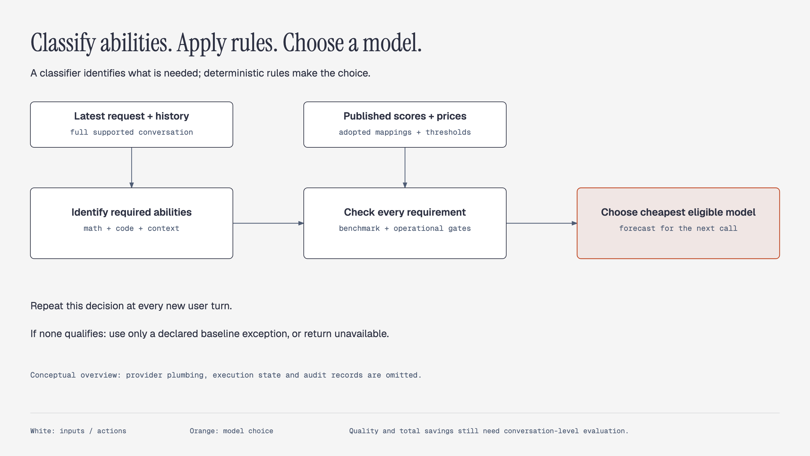
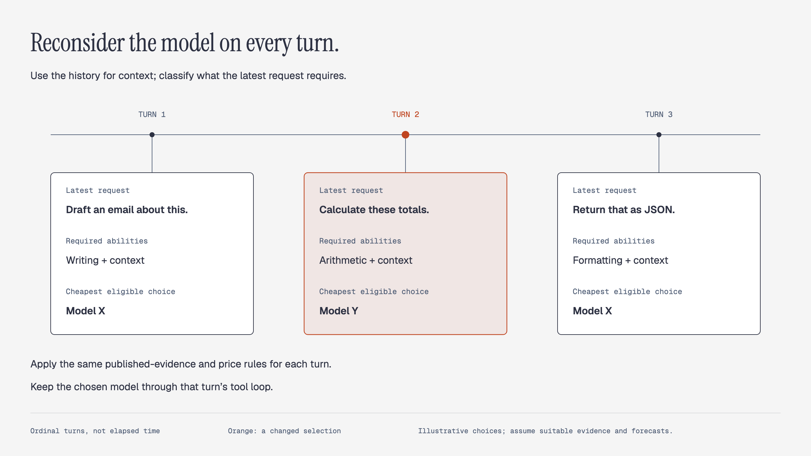

# Architecture Proposal for Capability Based Model Routing

Draft for review, 28 October 2026

Choose a language model for each conversation turn using the abilities required by the latest request, published model measurements, and explicit acceptance rules. The objective is lower total conversation cost while keeping answer quality within an agreed range.

The proposed architecture is one service with a small deterministic selection core, a versioned evidence catalog, a replaceable classifier, and provider adapters. Begin with a bounded pool of exact model configurations and portable text conversations. Reconsider selection at every user turn. A turn may include several exchanges between the model and tools; keep the chosen configuration through this tool loop, within its declared execution scope. Later, the same interface can operate at already exposed subtask boundaries.

The solver is the model chosen to answer the request. Select the candidate with the lowest estimated cost for its next model call, provided it passes every applicable benchmark requirement and operational constraint. This is a local decision. Complete-conversation evaluation determines whether those decisions deliver the intended savings and quality.

Start by [auditing published-evidence coverage and the potential savings](#1-audit-feasibility), then [validate classification](#2-validate-classification-and-policy). The [decisions before implementation](#decisions-before-implementation) identify the choices needed for this work. Proceed to provider integration and conversation trials only if those checks show a useful opportunity.

## Scope and boundaries

The system reuses published model measurements. It does not require a new candidate-model benchmarking pipeline, a difficulty predictor, a model-success predictor, or an autonomous task decomposer. Evaluating the classifier and finished router remains necessary and does not replace the published model profiles.

The first release supports full text histories within the chosen classifier's validated input limit. Images, inaccessible attachments, incompatible provider state and larger histories produce an explicit unsupported outcome. A later summary or retrieval mode must have its own coverage and evaluation results.

The initial workload, model pool, benchmark mappings and quality thresholds remain owner decisions. Competition mathematics and contest programming are possible pilot domains, rather than permanent limits on the architecture.

## Components and request flow



*Figure 1. The selection logic at a glance. The component table and request steps below provide the implementation detail.*

| Component | Responsibility | Contract |
|---|---|---|
| Context builder | Preserve messages, roles, tool records and the latest request separately | Return a frozen input view and a coverage manifest |
| Classifier adapter | Identify required abilities and task scenarios | Return structured labels and uncertainty; never choose a model |
| Catalog and policy loader | Admit published evidence, mappings, thresholds and price schedules | Produce an immutable validated snapshot |
| Selection core | Apply all requirements and minimize the declared cost estimate | Return a reproducible decision with exclusion reasons |
| Provider adapter | Check compatibility, render the request, execute and normalize usage | Preserve supported semantics and expose incompatible state |
| Ledger | Record decisions, attempts and reconciled spending | Distinguish estimates, reservations and actual charges |

These are modules in one service, not separate microservices. A transactional database can hold conversation revisions and the execution ledger; reviewed catalog and policy files can remain immutable artifacts.

For each user turn:

1. Freeze the conversation revision, latest request ID, policy/catalog versions and available provider observations.
2. Check that the previous response and tool sequence have reached a valid routing boundary.
3. Assemble the full supported classifier view, count its input and record exactly what it includes.
4. Classify the latest request with the history as supporting context. Validate the output and resolve it into evidence requirements.
5. Render and preflight each candidate offering, including its context capacity, required features, prices and supported conversation state.
6. Apply every evidence condition. Estimate cost for the surviving candidates and choose a deterministic minimum.
7. Persist the decision before dispatch. Stream the response and keep the chosen configuration through the current tool loop, within its declared execution scope. Suspend execution if an observable tool request or result breaches that scope.
8. Record actual attempts and usage, update the conversation revision and reconcile spending. Reconsider selection on the next user turn.

### Example: both requirements must pass

Suppose the latest request is “Solve this competition-math problem and provide a contest-ready program.” The history contains the problem. The classifier identifies competition mathematics and contest-code generation, using that history to understand the request.

For this simplified example, assume reviewed mappings accept a benchmark whose task and evaluation conditions match each scenario. The available scores below are admitted point estimates (reported scores) for the exact configurations behind offerings A–D; D has no coding evidence. The hypothetical policy freezes a separate floor of 85 for each benchmark. Only these two evidence conditions apply, and operational checks pass. All scores and cost units are invented.


*Figure 2. Apply each benchmark floor independently, then minimize the next-call forecast. Rows A–D represent the exact model configurations behind the example offerings.*

B receives `policy_qualified` status because it passes both floors and has the lowest next-attempt forecast among eligible offerings. A's mathematics score cannot compensate for its coding failure, and D's missing score cannot be inferred from its mathematics score.

The example assumes evidence admission and scenario matching have already been reviewed. The next sections explain those decisions; the [selection rules](#independent-requirements-and-model-selection) define the thresholds and other outcomes. Passing both gates does not establish performance on the combined request.

## Published evidence and model identity

### Configurations, offerings and observations

Separate three objects: a measured model configuration, an executable provider offering, and a published observation. A similar model name does not establish that an offering matches a measured configuration.

The configuration identifies the exact model release, reasoning effort or budget and material inference settings. Where relevant, it also identifies reduced numerical precision (quantization) and the surrounding prompts, orchestration and tools (the agent/tool scaffold). The offering binds that configuration to an endpoint, tokenizer, context/output limits, feature set and price schedule.

Each observation retains the benchmark release, scenario or subset, metric, scale, direction, evaluation protocol, source and dates. Preserve pass@1 versus pass@k: success for one sampled answer versus at least one success among k samples, under the publication's definitions. Also retain voting, sampling settings, tool access, revisions of the setup that runs and scores the test (the evaluation harness), and strict versus loose scoring. These differences can change the meaning of a reported result.

The following schema illustrates fields; it contains no actual measurements or prices:

```yaml
observation:
  id: evidence-id
  model_configuration_id: exact-model-and-inference-config
  benchmark:
    id: benchmark-and-release
    scenario: dataset-subset-language-and-length
    metric: exact-metric
    harness_revision: pinned-revision
    protocol_id: sampling-prompts-tools-and-scoring
  result:
    status: missing
    value: null
    scale: [0, 100]
    direction: higher
    sample_count: null
    published_uncertainty: null
  source:
    url: publication-url
    evaluator: publisher-or-evaluator
    evaluated_at: null
    published_at: null
    retrieved_at: null
    artifact_hash: content-digest
  comparability_group: reviewed-protocol-group
  admission:
    status: pending
    reliability_review: review-id
    uncertainty_rule: unresolved
    conflict_rule: unresolved
    reasons: []
  reuse_terms: {url: terms-url, review_status: unresolved}

offering:
  id: provider-and-exact-model-configuration
  measured_configuration_match: reviewed-match-id
  tokenizer_revision: tokenizer-id
  features_and_limits: specification-id
  price_schedule: versioned-price-card
```

### Evidence admission and uncertainty

Admission requires adequate provenance, configuration identity, protocol comparability and a documented reliability review. The review considers sample design and size, sampling or repeated-run methodology, scoring limitations, evaluator incentives, and known contamination or errata. A precise result or a named publisher alone does not establish reliability.

Assign each observation `admitted`, `pending` or `rejected`, with reasons; pending and rejected evidence cannot qualify a candidate.

Before activating a benchmark condition, freeze its uncertainty and conflict rules:

- **Published uncertainty:** retain its method and units, and specify whether qualification uses the admitted point estimate (the reported score) or an applicable published uncertainty bound. A bound expresses uncertainty using the publication's stated method. Do not invent intervals, combine incompatible uncertainty estimates or treat a score as a request-success probability.
- **Uncertainty not reported:** record it as unknown. A benchmark-specific rule may admit point-estimate qualification after reviewing the available methodology; without that explicit rule, admission remains pending. Missing uncertainty is neither zero uncertainty nor an automatic rejection of every otherwise useful publication.
- **Conflicting credible observations:** preserve them and assess comparability. Source precedence alone does not settle evidential strength. If defensible alternatives change pass/fail, keep qualification pending unless a frozen rule explicitly approves the named observation and records the conflict and rationale. Never select whichever report makes a candidate pass.

The feasibility audit must report whether qualification changes when using applicable published uncertainty bounds or credible alternative observations. Hypothetical changes to scores can supplement that audit but must be labelled assumptions, not statistically derived confidence intervals. Do not average incompatible results, borrow another reasoning setting's score, or turn missing evidence into zero.

### Reuse and catalog updates

Store the applicable reuse conditions for reported values and source artifacts. Public availability alone does not establish the terms for redistribution or ingestion.

Catalog and policy updates create new snapshots. Resolve reference-relative thresholds into frozen values, rather than allowing an updated reference score to change past policy silently. Activate new snapshots atomically for new decisions and retain the previous version for rollback. Provider aliases require revalidation when their underlying model changes.

## Ability labels and benchmark applicability

Use a small set of ability families plus scenario tags. Scenario tags describe the kind of work, not its difficulty.

| Ability family | Example scenarios | Candidate published evidence and limits |
|---|---|---|
| Mathematics | Routine arithmetic, competition problems, mathematical explanation | AIME is evidence about competition mathematics; applying it to other scenarios is a separate mapping decision |
| Programming | Contest generation, repair, repository maintenance | LiveCodeBench separates coding scenarios. Repository work needs appropriate evidence and scaffold matching |
| Instruction compliance | Exact format, length and explicit output constraints | IFEval measures verifiable instructions; it does not measure general answer quality |
| Context use | Retrieve prior facts, integrate documents, retain active requirements | Use task- and length-specific evidence; context capacity alone is insufficient |
| Tool use | Choose functions, construct arguments, complete stateful tool sequences | Match the benchmark category and tool mode to the application |
| General language | Writing, summarization, factual explanation | Admit relevant task-specific evidence where available; do not substitute an unrelated overall index |

These distinctions follow the scopes of [AIME](https://maa.org/maa-invitational-competitions/), [LiveCodeBench](https://livecodebench.github.io/), [IFEval](https://arxiv.org/abs/2311.07911), [RULER](https://arxiv.org/abs/2404.06654), [LongBench](https://arxiv.org/abs/2308.14508) and [BFCL](https://proceedings.mlr.press/v267/patil25a.html). LongBench includes summarization tasks, so summarization is not categorically unmeasured. [SWE-bench's published results](https://www.swebench.com/) identify an execution setting; applying them to a different agent or a bare model endpoint needs an explicit comparability decision.

Each mapping has one of three statuses:

- **Scenario matched:** the published task and evaluation conditions reasonably match the declared request scenario.
- **Proxy admitted:** the owner accepts a broader transfer assumption, with its rationale and limits recorded.
- **Unsupported:** no accepted evidence mapping exists.

Even a scenario match does not guarantee performance on a new request. Reliable measurement and relevant applicability are separate questions. A route that uses admitted proxies must expose them in its trace and coverage metrics.

For example, a travel conversation ending with “split these expenses” may require routine arithmetic and retrieval of prior amounts. The classifier should report those requirements. It should not relabel the task as competition mathematics merely to make an AIME measurement applicable.

**Example: connecting a request to evidence.** For the earlier invented request to solve a competition-math problem and provide a contest-ready program, an audit entry could connect the fields below. The record IDs and review decisions are hypothetical; scores and floors reuse the earlier B example. This illustrates the record contents without prescribing an additional schema.

| Required ability and scenario | Applicability judgment | Observation and activated condition |
|---|---|---|
| Mathematics: competition problems | `map-math`: scenario matched; assume the evaluated problem type and permitted assistance fit this request | `obs-B-math`: admitted for exact configuration B, score 87; activates `math-floor-85`, which passes |
| Programming: contest-code generation | `map-code`: scenario matched; assume the coding task and evaluation conditions fit this request | `obs-B-code`: admitted for exact configuration B, score 88; activates `code-floor-85`, which passes |

These rows cover B's two evidence requirements under the stated assumptions; operational preflight and the cost comparison still apply. If no coding applicability mapping is adopted, that requirement remains unsupported despite B's score. The selector then follows a permitted declared exception or returns unavailable.

Universal evidence requirements are optional policy. The core supports them, but this proposal does not impose an IFEval floor on every request. Operational constraints remain mandatory regardless of the labels.

## Classifier and conversation context

Give the classifier the latest request ID, ordered history, relevant system/application requirements, available tool definitions, completed tool records and the text attachments available to the solver. Keep the latest request in a separate field so the classifier identifies its requirements instead of the conversation's dominant topic.

The classifier receives no model prices or authority to choose candidates. Its stable output contract can support both typed classifiers and structured-output generative models:

```json
{
  "status": "classified",
  "taxonomy_version": "abilities-v1",
  "latest_request_id": "message-21",
  "required": [
    {"ability": "math", "scenario": "routine_arithmetic"}
  ],
  "plausible": [
    {"ability": "context_use", "scenario": "retrieve_prior_facts"}
  ],
  "unresolved": [],
  "support_refs": [],
  "input_manifest_id": "classifier-view-42"
}
```

Support references are optional diagnostics. The host validates any supplied references and always computes the input manifest itself. A typed classifier need not generate explanations or spans to satisfy the contract.

Classification status is `classified`, `partial` or `abstain`. Adapter failures such as overflow, timeout and invalid output remain distinct from a successful classification. A partial classification may still lead to a qualified route only when every uncertain requirement is represented by a named plausible label and the candidate satisfies all resulting requirements. Missing context or an unrepresented requirement prevents qualification.

The manifest records the source revision, included message and attachment IDs, omissions, preparation mode, tokenizer/model identity and measured input size. Including all source text establishes mechanical coverage; it does not establish that the classifier understood every relevant reference.

Start with **full supported history**, with no silent truncation. The limit is the selected classifier's admitted capacity minus its instructions, questions, serialization and any required output reserve. Overflow produces an explicit outcome. This means the first version may support a smaller conversation window than a solver; it must not advertise full coverage of a larger window.

Keep three context strategies distinct:

| Strategy | Benefit | What must be evaluated |
|---|---|---|
| Full history | Preserves source text and permits a clear inclusion audit | Label recovery and cost as history grows |
| Incremental state plus new messages | Can reduce repeated processing | Omitted or stale requirements and rebuild costs |
| Retrieval or summary | Can fit larger histories | Missed references, compression loss and preparation costs |

Reuse a complete classification only when the entire input, classifier version, questions, taxonomy and preparation settings match. Provider prefix caching may make full-history calls cheaper; it does not make a summary equivalent to the original text.

**Classifier candidates.** Evaluate a pinned Jev adapter using independent ability questions and a small structured-output generative comparator. This is a component shortlist, not a production choice. Jev documents structured state and parallel typed questions. Its current default limits are 64k tokens per request and 32k per question; optional 262k context is explicitly described as slower and less accurate. The documented price is $0.042 per million input tokens, with output free. [Jev models](https://docs.typesafe.ai/models), [state](https://docs.typesafe.ai/concepts/state), [typed questions](https://docs.typesafe.ai/primitives/noul).

A Jev preflight checks both state plus all questions against the request limit and state plus each question against the per-question limit. Expanded-context operation needs separate validation; documented capacity is not a validated routing window.

S1's released fixed schema and truncation to 512 tokens, including only 600 characters of history, make it unsuitable for this full-history contract as supplied. Its model card reports author evaluations, rather than validation on this workload. [S1 model card](https://huggingface.co/system1models/s1-llm-auto-router).

Do not interpret a generated confidence number as calibrated certainty, importance or success probability. Any numerical classification thresholds need their own validation. A policy can conservatively include all plausible known abilities; missing context or an unrepresented requirement still prevents qualification.

Treat transcript and tool text as data under fixed classification instructions. Give the classifier no execution tools, validate its schema and test attempts to manipulate routing. These measures do not establish immunity to prompt injection.

## Independent requirements and model selection

Let `L` be the union of identified abilities and plausible abilities that the uncertainty policy conservatively includes. Resolve them into a set of benchmark conditions, then add any deliberately configured universal evidence conditions.

For each condition `b`, a higher-is-better metric can use a reference-relative floor:

`score(candidate, b) >= score(reference, b) - allowed_loss[b]`

For a lower-is-better metric, use `<=` and add the allowed loss to the reference value. Margins use the metric's declared units: three percentage points is different from a three percent relative change. Freeze the exact reference configuration, admitted evidence and resolved threshold. Missing reference evidence makes that condition undefined. Absolute floors are another supported policy.

Here, `score` means the qualification statistic declared by that condition. Freeze the candidate and reference statistics, including any use of published bounds, before resolving the threshold; do not substitute a different statistic during selection.

Neither type of threshold establishes an equivalent permitted loss in real answer quality. Threshold values must be chosen explicitly; this proposal supplies no automatic or universally correct values.

The eligible set contains offerings that pass **all** operational checks and **all** activated evidence conditions. Select the offering with the lowest estimated charge for its next solver attempt (the ranking forecast), using stable offering ID to break exact cost ties. No weighted average may compensate for a failed condition.

```text
classify the latest request with its full supported history
if input is unsupported or requirements remain unrepresented:
    return declared_exception_or_unavailable(reason)

labels = required_labels union conservatively_included_plausible_labels
resolve every material requirement to an adopted applicability mapping
if any mapping is unsupported:
    return declared_exception_or_unavailable(unmapped_requirement)

gates = universal_evidence_gates union mapped_evidence_gates
eligible = candidates passing operational_preflight
for each gate:
    resolve evidence for the exact configuration using the gate's
    frozen admission, uncertainty and conflict rules
    exclude candidates with missing, pending, rejected or incomparable evidence
    compare the declared qualification statistic with the frozen threshold
    exclude candidates that fail the comparison
exclude candidates without a usable price/consumption forecast

if eligible is empty:
    return declared_exception_or_unavailable(no_eligible_model)
return minimum(eligible, key = [ranking_forecast, stable_offering_id])
```

Use three mutually exclusive outcomes:

| Outcome | Meaning |
|---|---|
| `policy_qualified` | All activated requirements pass; the trace identifies scenario matches and admitted proxies |
| `baseline_exception` | A declared reason permits the fixed baseline to execute after operational preflight; failed or unsupported evidence remains visible |
| `unavailable` | No permitted execution path passes preflight, including the baseline where an exception is allowed |

The baseline, permitted exception reasons and spending limits are proposed policy parameters for adoption. Until configured, the service cannot invent an exception. Empty classifier output or an intentionally empty universal gate set does not make an unmapped requirement pass. An exception never receives qualified status.

The [worked example](#example-both-requirements-must-pass) shows how these independent conditions exclude otherwise cheap offerings. Without difficulty prediction, different requests in the same scenario activate the same floors. This keeps selection simple, but may spend too much on easy requests and still fail on demanding ones. Evaluate that trade-off rather than adding an undeclared success predictor.

## Cost accounting and the optimization boundary

Keep four records separate:

| Record | Purpose |
|---|---|
| Ranking forecast | Estimated bill for the next solver attempt, before retries |
| Execution budget | Spending, token and attempt limits for execution, including permitted tool continuations and retries |
| Downstream estimates | Future turn or conversation costs, explicitly estimated or unknown |
| Actual charges | Recorded attempts and reconciled provider spending |

For each offering, apply its versioned price schedule to candidate-specific input and usage assumptions:

`forecast = uncached_input + cache_reads + cache_writes + billable_output_and_reasoning + request_fees`

Each term represents a charge, not a token count. Normalize currency and handle length-dependent price tiers. Avoid double counting reasoning tokens already included in billed output. Provider adapters must follow their own billing semantics rather than a universal input/output formula.

Count the actual rendered messages, instructions and tool schemas using the offering's tokenizer or supported counting interface. Record output/reasoning assumptions; an output maximum is a capacity or spending bound, not automatically expected usage. Later usage telemetry may improve consumption forecasts without changing the classifier into a success predictor.

Use declared cold/warm cache scenarios. Before evidence supports a cache hit, do not book the discount as certain. An incumbent with a warm provider cache may be cheaper than switching. Actual cache charges remain a separate reconciliation result.

Before integration, vary the declared output, reasoning and cache assumptions and report changes to the selected offering and estimated savings. A saving that depends on one unsupported consumption assumption remains unverified. During the pilot, compare forecasts with actual first-attempt charges separately from the cost of later tool calls, retries and repairs. This distinguishes forecast errors from locally correct choices that produce expensive completed turns.

Classifier and context-preparation costs count in total router spending. When common to every surviving offering, they do not change the ordering. A retry reserve is spending capacity, not an expected bill; do not manufacture retry probabilities to incorporate it into ranking.

The first version minimizes the forecast of **one next solver attempt**, then pins the offering through the tool loop. It does not minimize unknown tool-loop work, the whole turn, or the future conversation. Complete-conversation totals include classifier calls, cache effects, all solver attempts, cancellations, repairs, exceptions and other attributable fees.

## Conversation portability and execution

Maintain a canonical transcript with conversation revision, turn ID, message/event IDs, roles, typed content parts and source references. Keep provider-specific request IDs and opaque continuation state in separate envelopes.

A provider adapter must report whether it can faithfully render the supported history and required output/tool modes. Do not assume private reasoning state, thought signatures, provider conversation IDs, KV cache or pending tool calls transfer to another model. Completed tool results may be portable when rendered as attributed records under the target API's rules.

Switch only at a clean supported boundary. Keep a model pinned while tool calls are pending or opaque state must be continued. If no permitted offering can continue, return an explicit unavailable outcome rather than discarding state.

### Example: model choice across turns

The latest request can change the required abilities while still relying on earlier turns. This illustration assumes suitable admitted evidence and cost forecasts for each scenario; X and Y denote hypothetical exact model configurations, rather than fixed assignments by topic.



*Figure 3. Reconsider selection at each new user turn, using history as context. Keep the selected model through that turn's tool loop.*

### Requirements revealed by tools

Qualification applies to the classified input and a declared scope of permitted tool work; it does not cover arbitrary future content. Each admitted tool workflow must identify its permitted calls, expected result forms and bounded requirement scenarios. The application supplies this scope, rather than allowing the solver to expand it.

For the first pilot, retrieval workflows that can introduce unbounded unseen requirements use a configured baseline exception from the start, or are unavailable if no exception is permitted. They can enter qualified routing later when the application exposes the retrieved material at an existing clean routing boundary. This does not require an autonomous task decomposer or mid-loop model switching.

If a tool request or result observably breaches the declared scope:

1. Record `scope_changed` and preserve completed results.
2. Suspend qualified execution before another model call or external action.
3. End that execution as unavailable. Do not silently retain qualified status or switch providers.

A separate routing decision requires a supported clean boundary and a fresh compatibility check. Previously emitted output and completed side effects remain recorded. These checks detect declared contract violations; they do not guarantee detection of every newly implied semantic requirement, which must also be exercised in the pilot.

### Execution state and audit records

Use a conversation revision check or transactional claim to prevent concurrent turns from committing incompatible histories. New user input must queue or cancel through an explicit transition. Record cancellation, partial output and any eventual usage.

Normalize streaming into start, text delta, tool request, usage, finish and error events. Before visible output, a permitted retry is a separate attempt. After output begins, do not silently splice another model's response into the stream. Provider timeouts do not prove non-execution or zero billing. Preserve existing tool-execution idempotency rules; retries must not blindly repeat external side effects.

For each decision, retain:

- Conversation revision and authorized input identity, plus input manifest and classifier/question versions.
- Normalized classifier output, uncertainty handling and applicability mapping IDs.
- Catalog/policy snapshot, exact evidence records, thresholds and every candidate's exclusion reasons.
- Evidence reliability decisions, uncertainty/conflict rules, permitted tool scope and any scope-change event.
- Cost assumptions, cache scenarios, estimated range, chosen offering and outcome status.
- Provider request and attempt IDs, execution budget, latency, usage and reconciled charges.

Unavailable usage is unreconciled, not zero. A hash identifies retained input but cannot reconstruct it; exact replay requires authorized retention of the original material. Replaying a selection uses recorded classification and observations. Rerunning the classifier is a separate experiment.

## Evaluation and acceptance

### 1. Audit feasibility

Take a representative sample of complete target conversations and annotate latest-request abilities, references, active constraints and context sizes. Join those requirements to admitted published evidence and price schedules. Report scenario-matched coverage, proxy dependence, unsupported cases and cheaper eligible alternatives. No candidate-model outputs are needed to build these profiles.

Group requests by the set of benchmark requirements they activate. For each set, report its frequency, eligible exact offerings, the offering with the lowest cost forecast, exception cases and sensitivity to evidence and consumption assumptions. Different labels do not create an additional routing opportunity if they lead to the same benchmark requirements. Requests in a group can still have different operational constraints and cost forecasts. Include mixed requirements and variation within each scenario.

Run an optimistic diagnostic using human-reviewed labels and zero classifier cost, then add estimated or measured classification overhead explicitly. Compare with a credible economical fixed configuration and, where one exists, the cheapest fixed configuration satisfying the union of the pilot's evidence requirements. This tests whether conditional eligibility offers an opportunity beyond a fixed choice. It is a diagnostic under declared assumptions, not a bound on real conversation quality or spending.

If one economical model wins most cases, compare against a simpler fixed or narrowly conditional policy. Rare routes may still be necessary to maintain quality. Stop or revise the pilot when evidence coverage or incremental benefit is insufficient after overhead and the agreed quality requirements, rather than because expensive routes are rare. Check whether the opportunity survives credible output, reasoning, cache and evidence assumptions before substantial integration work.

### 2. Validate classification and policy

Reserve held-out conversations that were not used to develop or tune the classifier. Have reviewers resolve disagreements about the required labels (adjudication). Compare the Jev candidate and a pinned generative comparator on those conversations.

Measure per-ability precision (the proportion of assigned labels that are correct) and recall (the proportion of required labels found). Also measure omitted material abilities, exact label sets, unresolved references, false qualification of unsupported requests, abstention, latency and actual classifier cost by history size. Include obsolete topics, changed requirements, distant references, mixed abilities and adversarial tool text. Keep development and held-out data separated by conversation.

Run the frozen selector twice for each held-out request: once with classifier requirements and once with human-reviewed requirements, keeping evidence, prices and operational observations identical. Measure selections that violate a condition required by the reviewed labels, unnecessary exclusions or exceptions, extra estimated spending and disagreements that leave eligibility and selection unchanged. These are consequences under the benchmark policy, not measured answer failures. Report how conservative inclusion of plausible labels trades consequential omissions against lost cheap routes. Where the application already supplies reliable task modes, also compare a simple mode-to-model table; do not assume otherwise unavailable labels are free.

Check the deterministic selector with illustrative catalogs: conjunctive gates, missing or pending evidence, uncertainty/conflict rules, configuration mismatch, score direction, threshold equality, unsupported context/state, tool-scope changes, no survivors and exact ties. Every qualified decision must satisfy its activated policy. This tests the router, not the capabilities of every candidate model.

### 3. Use stable-context replay diagnostically

Frozen transcript prefixes help inspect labels, gate results, selection changes and price sensitivity. They do not establish the outcome of conversations whose future turns respond to different answers.

### 4. Compare complete conversations

Use three arms (comparison groups): the router, a credible strong fixed configuration, and a credible economical fixed configuration. Select baselines and acceptance rules before testing. Match the application tools, environment and budget rules; fixed arms pay their natural caching costs without a routing classifier.

Let conversations develop from each arm's actual responses. Include combined-ability tasks, rare quality-critical exceptions and tool results that expose new requirements.

Either randomly assign whole conversations to the comparison groups, or use controlled interactive tasks with an appropriate paired design that compares matched tasks across groups. Conversations involving the same users or repeated tasks may be correlated. Use clustered analysis to account for that dependence rather than treating their outcomes as independent observations.

Simulated users remain a limited proxy for real interaction. Assess successful completion and consequential errors independently of the routing gates, with assessors blinded to the assigned arm where practical.

The quality test asks whether the study can rule out a loss larger than the owner agreed to accept. Choose the primary quality endpoint (the main quality measure), serious-error rules, acceptable loss margin, confidence level, sample-size method and stopping rule in advance.

For a higher-is-better measure, the lower confidence bound for `quality(router) - quality(strong)` must exceed the negative acceptable-loss margin. This uses the lower end of the estimated difference at the chosen confidence level, rather than only its point estimate. Failing to detect a difference—a non-significant result—is not evidence of maintained quality. A pilot can estimate the variability needed to size the later study.

Report quality and completion, total billed conversation cost, cost per successful conversation, repair/escalation work, classification overhead, cache behavior and latency tails. Include all allocated conversations, exceptions and failed attempts. Report outcomes by ability combination and context length so averages cannot hide weak segments.

The economic criterion must also be explicit. A saving against the expensive baseline alone does not establish routing value: the result must explain why routing is preferable to the economical fixed alternative at the required quality level.

## Decisions before implementation

| Decision | Required choice |
|---|---|
| Target workload | Representative conversations, languages, supported scenarios and context distribution |
| Solver pool | Exact reference and alternative configurations, compatible offerings and price schedules |
| Evidence policy | Reliability admission, uncertainty/conflict rules, comparability groups, scenario/proxy mappings and updates |
| Benchmark qualification policy | Separate margins or absolute floors; intentionally chosen universal gates |
| Classifier | Pinned candidate, question set, uncertainty rule and validated context envelope |
| Execution and exceptions | Permitted tool scope, newly revealed requirements, baseline offering, unavailable behavior and execution budgets |
| Acceptance | Conversation-quality margin, economic criterion, latency limits and evaluation design |

The next milestone is a small evidence/applicability catalog and coverage/economics audit, followed by classifier validation. This work requires judgment about benchmark methodology and its fit to the workload, rather than just collecting leaderboard numbers. Record those judgments in the admission and applicability records described above; unresolved evidence remains pending.

Proceed to provider integration and conversation trials only if those checks show a useful opportunity. Expand the model pool and context strategies after the initial policy earns its complexity.

The architecture depends on three hypotheses: published evidence transfers usefully to the selected workload, including combinations of abilities; the classifier identifies the material requirements at acceptable cost; and the resulting local selections improve complete-conversation economics. The evaluation stages test those hypotheses without requiring a new model-profile benchmark program. Passing separate ability gates does not establish joint-task performance, and passing the optimistic economic diagnostic does not establish actual savings.
